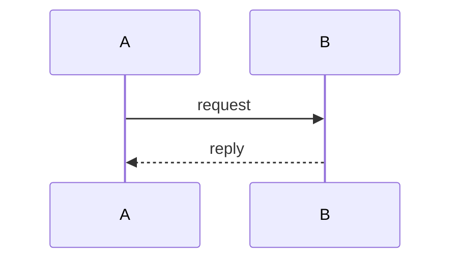

# Deck title

<p class="text-xl c-text2">One-line subtitle</p>
<p class="small c-muted mt-3">Your name</p>

---
layout: divider
part: 1
minutes: 5 min
---

# Opening

What this part covers

---

# A content slide

<div class="insight mt-4">
  <div class="cue c-orange"><tabler-bulb class="icon" /> Cue</div>
  <div>The point of this slide, in one sentence.</div>
</div>

<div class="grid grid-cols-3 gap-4 mt-6">
  <div class="panel blue">
    <div class="head c-blue"><tabler-topology-star-3 class="icon" /> Blue</div>
    <p class="small">Panel colors: blue, orange, purple, green, red, dim.</p>
  </div>
  <div class="panel orange">
    <div class="head c-orange"><tabler-code class="icon" /> Orange</div>
    <p class="small">Icons come from the Tabler set, as <code>tabler-*</code>.</p>
  </div>
  <div class="panel green">
    <div class="head c-green"><tabler-check class="icon" /> Green</div>
    <p class="small">Use <code>v-click</code> when a block should wait for a click.</p>
  </div>
</div>

<div class="mt-5">
  <span class="pill cmd">command</span>
  <span class="pill evt">event</span>
  <span class="badge">badge</span>
  <span class="badge fill">filled</span>
</div>

<div class="key mt-5">A callout. Use <code>key</code> for the line you want remembered.</div>

---

# Code

```ts
export const answer = 42
```

---

# A sequence



---
layout: center
class: text-center
---

# Questions?
